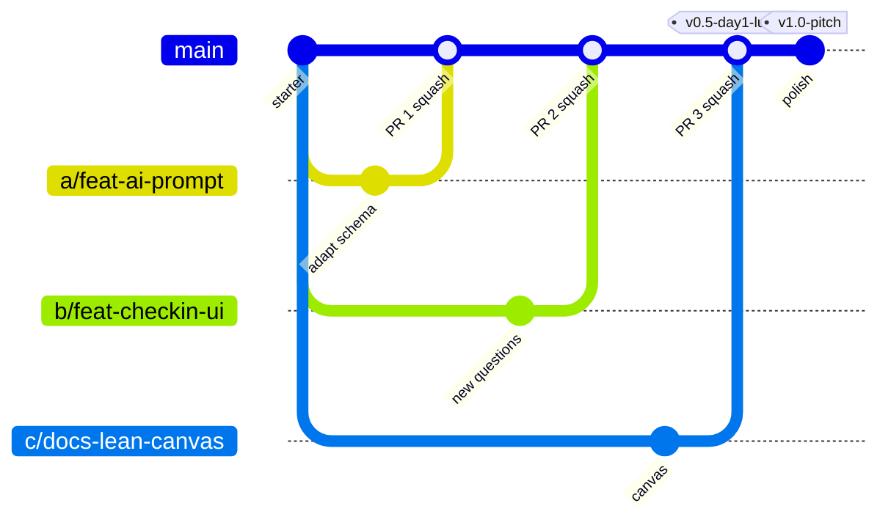

# Team Git Workflow (3 people, 2 days, zero broken demos)

## The rules in one screen

1. **`main` is always demoable.** It auto-deploys to production on Vercel. Nobody pushes to `main` directly.
2. **Short-lived branches, small PRs.** Merge every 60 to 90 minutes. A PR older than 2 hours is a risk.
3. **Stay in your lane** (ownership zones below) to avoid conflicts.
4. **CI must be green** (lint + typecheck + build) before merge.
5. **Check the Vercel preview URL** on your phone before merging any UI change.
6. **Code freeze Day 2 at 12:00.** Tag `v1.0-pitch`. After that, hotfixes only.



## One-time setup (Person A, 5 minutes)

- GitHub, **Settings, Collaborators**: add the other two with write access.
- **Settings, Branches, Add rule** for `main`: require a pull request before merging; require status check `build` to pass; (optional for speed) require 1 approval.
- Connect Vercel (see `docs/05-STACK-AND-DEPLOY.md`).
- Create labels: `feat`, `fix`, `docs`, `pitch`, `blocked`, `demo-critical`.
- Optional: a GitHub Project board with columns **To do, Doing, Review, Done**. One issue per task, assigned to one person.

Each teammate:

```bash
git clone https://github.com/nickkhymenko/gillmore-hackathon.git
```

```bash
cd gillmore-hackathon && npm ci && cp .env.example .env.local
```

## Ownership zones

| Person | Owns | Avoid editing without a heads-up |
|---|---|---|
| A: Builder | `src/app/api/**`, `src/lib/**`, `.github/**`, config files | Page layouts |
| B: Product and Demo | `src/app/**/page.tsx`, `src/components/**`, `public/**` | API contracts in `src/lib/types.ts` |
| C: Business and Pitch | `docs/**`, `pitch/**`, `README.md` | Code |

**Shared contract:** `src/lib/types.ts`. Changes to it need a message in the team chat first, because both API and UI depend on it.

## Daily loop (copy these)

Start a task from the latest `main`:

```bash
git switch main && git pull --ff-only
```

```bash
git switch -c b/feat-checkin-photo
```

Branch names: `<your initial>/<type>-<short-description>`, e.g. `a/feat-vet-brief`, `b/fix-mobile-nav`, `c/docs-lean-canvas`.

Commit often with Conventional Commit messages:

```bash
git add -A && git commit -m "feat(checkin): add photo upload with compression"
```

Types: `feat`, `fix`, `docs`, `style`, `refactor`, `chore`, `pitch`.

Before pushing, update with the latest `main` to surface conflicts on your machine, not on GitHub:

```bash
git fetch origin && git rebase origin/main
```

```bash
git push -u origin HEAD
```

Open a PR (GitHub shows a "Compare and pull request" button). Fill in the template. Wait for CI and the Vercel preview, check it, then **Squash and merge**. Delete the branch.

## Resolving a conflict during rebase

```bash
git status
```

Open each conflicted file, keep the right parts, remove the `<<<<<<<`, `=======`, `>>>>>>>` markers, then:

```bash
git add <file> && git rebase --continue
```

Stuck? Abort and ask the file's owner:

```bash
git rebase --abort
```

After a rebase you must force-push your own branch (never `main`):

```bash
git push --force-with-lease
```

## Milestone tags

| Tag | When |
|---|---|
| `v0.1-skeleton` | Starter merged and deployed |
| `v0.5-day1-lunch` | Day 1, 13:00 |
| `v0.9-day1` | Day 1, 18:00 |
| `v1.0-pitch` | Day 2, 12:00 code freeze |

```bash
git switch main && git pull --ff-only && git tag v1.0-pitch && git push origin v1.0-pitch
```

If something breaks late, Vercel lets you **instantly roll back** production to any previous deployment (Deployments, pick one, "Promote to Production").

## Code freeze protocol (Day 2, 12:00 onwards)

- Only `fix:` PRs labelled `demo-critical`.
- Needs a second person to test the preview URL on a phone.
- If in doubt, do not merge. A working demo beats a better broken one.

## Secrets

- Never commit `.env.local` or any key. `.gitignore` already excludes `.env*` except `.env.example`.
- If a key is ever committed: revoke it in Google AI Studio immediately, create a new one, update Vercel.

## Docs and slides

- Docs live in `docs/` as Markdown (diagrams in Mermaid render on GitHub).
- Slides are co-edited live in Google Slides or Canva. Export a PDF into `pitch/` at each milestone tag so the repo always holds the latest deck.
