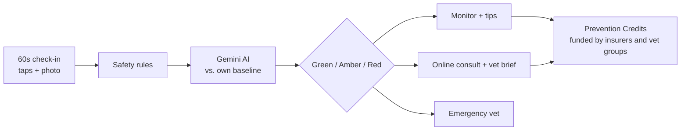

# Prevently: prevention that pays

**Gillmore Hackathon 2026 · Pet Healthcare in the AI Era · Warwick Business School, 14 to 15 Nov**

A 60-second weekly AI pet health check-in that compares each pet with **its own baseline**, routes early warnings into the right level of vet care, writes a vet-ready brief, and turns the claims prevention avoids into **Prevention Credits** shared with owners. Built to plug into Doctapet's triage, online consult and white-label platform.



## Quick start

```bash
npm ci && cp .env.example .env.local
```

Add a free Gemini key from https://aistudio.google.com/apikey to `.env.local` (optional: without it the app runs in rules-only demo mode).

```bash
npm run dev
```

| Page | What |
|---|---|
| `/` | Story and stats |
| `/checkin` | The owner check-in, with 3 one-tap demo scenarios and "seed history" |
| `/pet` | Health trajectory vs. own baseline, credits wallet |
| `/partner` | Insurer / vet group ROI model with live sliders, early-warning queue |
| `POST /api/checkin` | AI + safety assessment API |
| `GET /api/economics` | Shared-savings ROI API |
| `GET /api/health` | AI mode check |

## Docs

| Doc | For |
|---|---|
| [docs/01-GAME-PLAN.md](docs/01-GAME-PLAN.md) | Timeline, roles, judging map, statement pivot map, mentor plan |
| [docs/02-SOLUTION.md](docs/02-SOLUTION.md) | Solution, components, architecture and other diagrams, business model, regulation |
| [docs/03-PITCH-AND-QA.md](docs/03-PITCH-AND-QA.md) | 6-minute script, Q&A bank |
| [docs/04-RESEARCH-PROMPT.md](docs/04-RESEARCH-PROMPT.md) | Prompt for a research AI (company, market, competitors, tech) |
| [docs/05-STACK-AND-DEPLOY.md](docs/05-STACK-AND-DEPLOY.md) | Stack, API reference, deploy to Vercel, share via QR |
| [CONTRIBUTING.md](CONTRIBUTING.md) | Git workflow for the three of us |

## Repo map

```
src/
  app/
    api/checkin/route.ts     POST: validate, safety rules, Gemini, safety floor, trend, credits
    api/economics/route.ts   GET: partner ROI model
    api/health/route.ts      GET: AI mode
    checkin/ pet/ partner/   pages
  components/ResultCard.tsx  assessment UI
  lib/
    types.ts                 shared contract (zod schemas)
    safety.ts                red-flag rules, baseline trend, credits
    ai/gemini.ts             Gemini multimodal call with JSON schema
    ai/rules.ts              rules-only fallback (demo never breaks)
    economics.ts             shared-savings model (reading-guide figures)
    store.ts                 browser persistence (swap for Supabase later)
docs/                        plan, solution, pitch, research prompt, stack
```

*Triage and monitoring support only. Not a diagnosis. Only a registered veterinary surgeon can diagnose or prescribe.*
