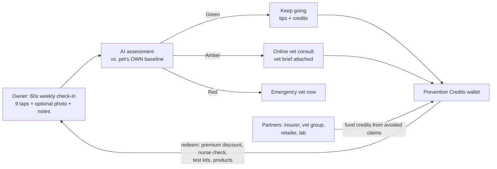
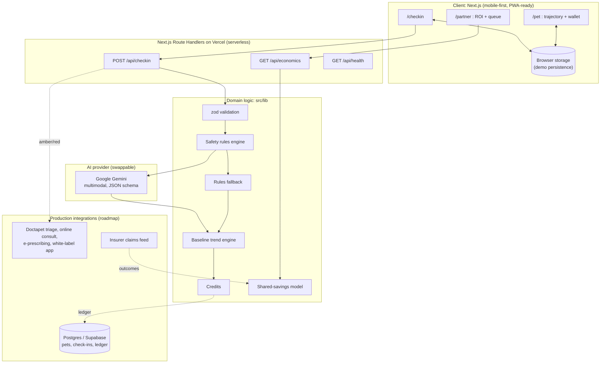
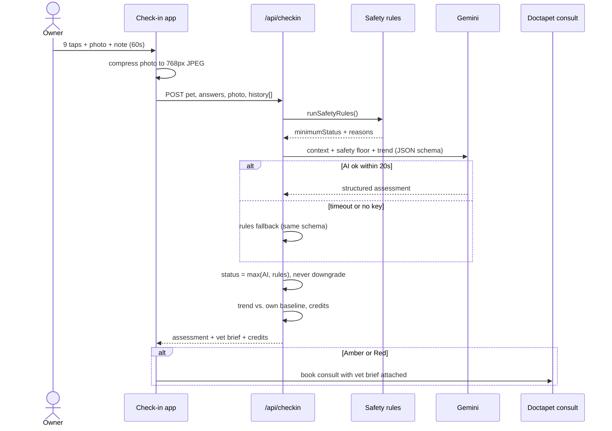
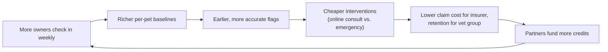
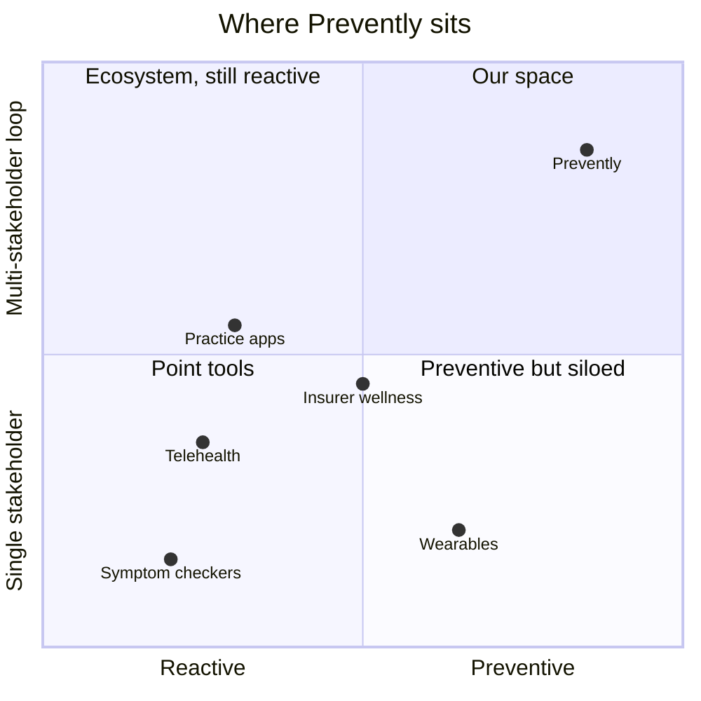
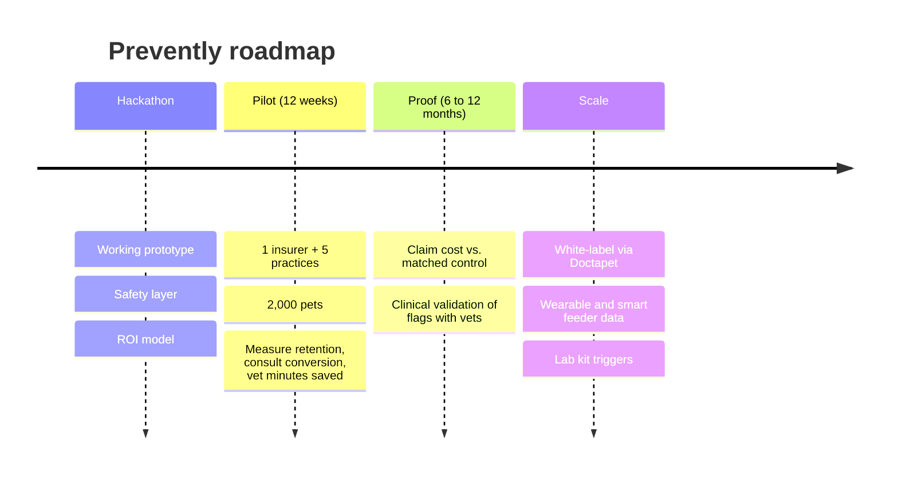
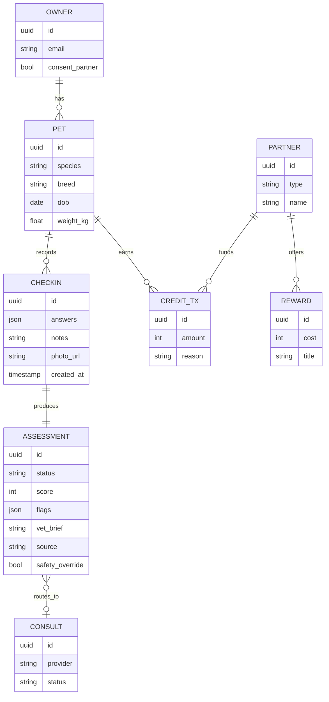

# Proposed Solution: Prevently

**One line:** a 60-second weekly AI check-in that compares each pet with *its own* baseline, routes early warnings into the right level of vet care, and turns the claims it prevents into **Prevention Credits** shared with the owner.

**Tagline:** *Prevention that pays.*

---

## 1. The problem (from the reading guide)

- UK vet prices are up **about 75% in ten years**, twice inflation; up **7.1% in 2025** vs. 3.6% inflation.
- Annual spend is **more than £1,900 per pet**.
- UK insurers paid **£1.23bn** in claims in 2024; **average claim £685**; about **1.8m claims a year** (around 4,900 a day) across **4.6m policies**.
- Owners increasingly see pets as family (69% of Millennials and Gen Z) and want problems *caught early, not treated late*.

**The insight:** pet healthcare is reactive because of a **misaligned incentive**. Prevention costs the owner time and money *now*; the savings land with the insurer and the system *later*. Between vet visits (often a year apart) nobody is watching the slow drift that becomes a big claim: increased thirst in an older dog, a cat straining in the litter tray, stiffness after walks.

## 2. The solution

### What makes it original

1. **Baseline-relative detection.** Each pet is compared with itself, not with a population average. A Labrador whose score slides from 91 to 72 over three weeks is flagged even though 72 looks "fine" in isolation.
2. **Hardware-free longitudinal data.** No collar or wearable required. A phone, 60 seconds, once a week. Multimodal AI reads the answers, the free-text note *and* the photo.
3. **Shared-savings economics.** Insurers and vet groups fund small credits out of the claims and emergency visits that prevention avoids. Owners get paid (in kind) for prevention, closing the incentive gap.
4. **Vet-ready output.** Every amber or red result produces a structured clinical brief for the vet, so the online consult starts at minute 3, not minute 0.
5. **Safety by design.** A deterministic rules layer runs before and after the AI. **The AI can escalate a case but can never downgrade it.**

## 3. Key components

| # | Component | What it does | Status in prototype |
|---|---|---|---|
| 1 | **Check-in app** (mobile web, white-labelable) | 9 tap questions, notes, photo with on-device compression | Built: `/checkin` |
| 2 | **Safety rules engine** | Hard-coded red flags (laboured breathing, cat urinary straining, toxins, bloat, collapse). Sets a minimum status | Built: `src/lib/safety.ts` |
| 3 | **AI assessment service** | Gemini multimodal, structured JSON output (status, score, flags, next step, tips, vet brief, photo observations) | Built: `src/lib/ai/gemini.ts` |
| 4 | **Baseline trend engine** | Rolling baseline of the last 4 check-ins; flags drops of 8+ and 15+ points | Built: `computeTrend()` |
| 5 | **Care router** | Green / Amber / Red into: monitor, Doctapet online consult, emergency vet | Built (UI); integration is a Doctapet API hook |
| 6 | **Vet brief generator** | Clinical summary for the consulting vet | Built: part of AI schema |
| 7 | **Prevention Credits ledger** | Earn per check-in, photo and streak; redeem with partners | Built (demo: browser storage) |
| 8 | **Partner dashboard and ROI API** | Shared-savings model, early-warning queue | Built: `/partner`, `GET /api/economics` |
| 9 | **Rules-only fallback** | Same output schema without AI, so the product never fails | Built: `src/lib/ai/rules.ts` |

## 4. Architecture

### Check-in sequence

### Stakeholder value loop (the flywheel)

## 5. Value proposition per stakeholder

| Stakeholder | Pain today | What Prevently gives them |
|---|---|---|
| **Pet owner** | Rising bills, guilt of "I didn't notice", no idea when to worry | Early warning in 60s a week, clear next step, credits that cut costs |
| **Vet practice / group** | Consults start from scratch, emergency load, client churn in a consolidating market | Pre-triaged structured brief, earlier and cheaper cases, weekly engagement with clients |
| **Insurer** | £685 average claim, rising frequency, low engagement between renewals | Lower claim severity among engaged pets, a weekly touchpoint, better risk data, retention |
| **Retailer / lab / brand** | Untargeted marketing | Relevant, consented offers triggered by real needs (e.g. urine test kit after a thirst flag) |
| **Doctapet** | Needs new B2B revenue on existing products | A prevention layer that feeds its triage, consult and prescribing funnel, sold white-label to insurers and groups |

## 6. Business model

**B2B2C SaaS, sold to insurers and vet groups, white-labelled on Doctapet rails.**

- **Platform fee:** per engaged pet per month (prototype default £1.00).
- **Credits pool:** funded by the partner (default £6 per engaged pet per year), redeemable with retail and lab partners (who pay for placement: second revenue line).
- **Outcome upside (later):** share of measured claim savings once pilot data proves it.

### Unit economics (illustrative insurer, defaults in `/partner`)

Claim frequency from the reading guide: $1.8\text{m} / 4.6\text{m} \approx 0.39$ claims per policy per year, so expected claim cost per policy is $0.39 \times £685 \approx £268$.

For a book of 100,000 policies with 30% engaged (30,000 pets):

$$\text{Claim cost on engaged pets} = 30{,}000 \times £268 \approx £8.04\text{m}$$

$$\text{Partner cost} = 30{,}000 \times (£1 \times 12 + £6) = £540{,}000$$

$$\text{Break-even reduction} = \frac{£540{,}000}{£8.04\text{m}} \approx 6.7\%$$

At a 10% reduction in claim cost among engaged pets: gross saving about £804k, net benefit about £264k, ROI about $1.5\times$. All non-reading-guide numbers are **assumptions** we state openly and test in the pilot.

### Lean canvas (draft, refine in the 12:30 session)

| Block | Content |
|---|---|
| Problem | Reactive care; misaligned incentives; nobody watches between annual visits |
| Customer segments | Paying: insurers, vet groups. Users: dog and cat owners (early adopters: insured owners of senior pets) |
| Unique value proposition | Prevention that pays: early warning for owners, cheaper claims for insurers |
| Solution | 60s check-in, own-baseline AI, safety-floored triage, vet brief, credits |
| Channels | Doctapet white-label inside insurer and vet group apps; insurer onboarding emails |
| Revenue | Per engaged pet per month; retail and lab placements; later outcome share |
| Cost structure | AI inference (pennies per check-in), hosting, vet clinical governance, partnerships |
| Key metrics | Weekly active check-in rate; amber to consult conversion; claim cost per engaged pet vs. control |
| Unfair advantage | Longitudinal per-pet baselines that compound over time; Doctapet distribution |

## 7. Market and competition

> Verify and extend with the research prompt (`docs/04-RESEARCH-PROMPT.md`). Names below are well-known players; check current status.

| Category | Examples | What they do | Gap Prevently fills |
|---|---|---|---|
| Vet telehealth | Joii, FirstVet, Vetster | Video consults on demand | Reactive: owner must already be worried |
| Practice client apps | PetsApp, practice portals | Booking, messaging, reminders | No health monitoring or financial loop |
| Wearables and smart devices | Tractive, Whistle, smart feeders | Activity and location data | Needs hardware; data rarely reaches vet or insurer decisions |
| Insurer wellness add-ons | Various UK insurers' vet helplines and wellness plans | Helplines, discounts | Not personalised, no early detection |
| AI pet health point tools | e.g. pain or symptom checkers | One-off assessments | No longitudinal baseline, no incentive mechanism |

**Positioning:** everyone else is either *reactive* or *single-stakeholder*. Prevently is **preventive and multi-stakeholder**, with a financial mechanism that makes it worth everyone's while.

## 8. Feasibility, safety and regulation (UK)

| Area | Our approach |
|---|---|
| **Veterinary Surgeons Act 1966** (only vets diagnose and treat) | We never diagnose or prescribe. Output is "triage and monitoring support"; every amber or red routes to a vet |
| **RCVS guidance** (remote consults and prescribing, "under care") | Prescribing stays inside Doctapet's existing vet-led consult and prescribing flow |
| **AI safety** | Deterministic red-flag rules; AI can escalate but never downgrade; structured JSON; low temperature; rules fallback; audit trail of inputs and outputs (production) |
| **UK GDPR** | Owner data minimised; explicit consent for photos and partner sharing; UK/EU hosting; DPIA before pilot |
| **FCA / insurance** | Credits are the insurer's own wellness benefit; Prevently is a technology provider, not an insurer or broker; Consumer Duty fair-value review with partner |
| **CMA vets market work** (price transparency) | Credits and early online consults push toward cheaper, transparent care |
| **Gaming the credits** | Credits are small, capped, need photo evidence for bonuses; anomaly checks on answer patterns |

**Technical feasibility:** the prototype already runs end to end. Production needs a database, auth, Doctapet API integration and clinical governance sign-off: weeks, not years.

## 9. Validation plan and roadmap

**Pilot KPIs:** 4-week check-in retention above 50%; amber to consult conversion above 30%; vet-rated brief usefulness 4/5+; claim cost per engaged pet vs. matched control (difference-in-differences).

## 10. Data model (production)

