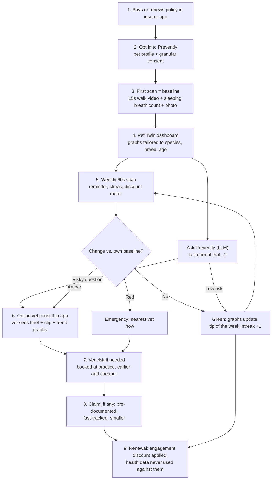
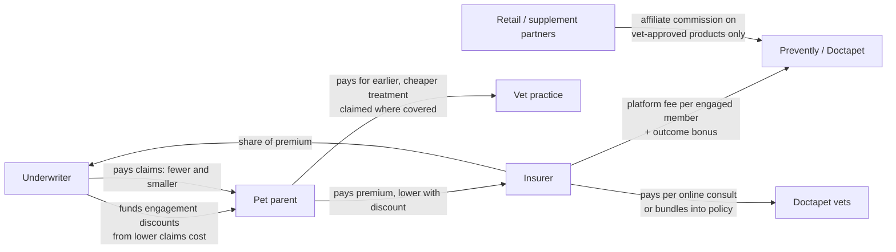
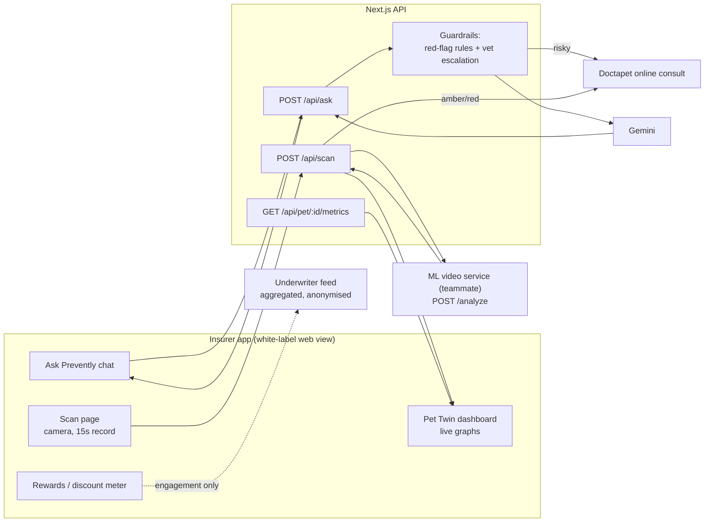

# Build Plan for Problem Statement 1: "Prevention that pays"

**Product:** *Prevently*, a white-label prevention module that an insurer switches on inside **its own app** (powered by Doctapet). It has three parts:

1. **Pet Twin dashboard:** a UI that adapts to the species, breed and age, with live graphs of that pet's own data against its own baseline.
2. **Weekly video scan:** the owner films the pet for 15 to 30 seconds, our ML model (built by teammate) extracts health signals, and the graphs update.
3. **Ask Prevently:** an LLM assistant with guardrails that answers care questions and pushes risky ones to an online vet consult. It captures "the question an owner had days or weeks earlier", which is exactly where the brief says most claims start.

Engagement is rewarded with a **premium discount that can only go down, never up**.

---

## 1. Who the four parties are (say this clearly in the pitch)

| Party | Who they are | What they care about |
|---|---|---|
| **Pet parent** | The policyholder using the insurer's app | Pet's health, peace of mind, cost |
| **Vet** | The practice (or Doctapet online vet) that sees the pet | Earlier, better-informed cases; booked appointments; client loyalty; less admin |
| **Insurer** | The brand that sells the policy and owns the app and customer (often a broker or managing general agent) | Retention, acquisition, engagement, differentiation, claims experience |
| **Underwriter** | The risk carrier that prices the risk, holds the capital and pays the claims (sometimes the same company as the insurer, often not) | Loss ratio, pricing accuracy, claims severity, fraud, regulatory capital and compliance |

## 2. Member journey (first scan to vet visit)



**Habit not chore (the brief's question):** under 60 seconds; scan feels like a moment with your pet, not a form; graphs that are *about my pet*; streaks; visible discount meter ("4.5% off your renewal so far"); seasonal nudges (fireworks, ticks, heat).

### What each party sees at each step

| Step | Pet parent | Vet | Insurer | Underwriter |
|---|---|---|---|---|
| Opt-in | Clear consent screen, "can only lower your premium" | | Engagement starts | |
| Baseline scan | Pet Twin created | | | |
| Weekly scans | Graphs, tips, discount meter | | Weekly active members | Aggregated engagement and trend indices (anonymised) |
| Ask Prevently | Answers in plain English, vet nudge when risky | | Questions captured early | Volume of early contacts (aggregate) |
| Amber flag | Consult in 1 tap | Pre-triaged brief, clip, trend history | Consult cost (cheaper than a claim) | Early-intervention event logged (aggregate) |
| Vet visit | Earlier treatment | Booked appointment, better history | | |
| Claim | Faster, pre-documented | Less paperwork | Better claims experience | Lower severity, less fraud |
| Renewal | Discount applied | Client retained | Policy retained | Lower loss ratio |

## 3. Value for all four parties (no one at another's expense)

| Party | Value | How we prove it in the demo |
|---|---|---|
| Pet parent | Early warning; answers 24/7; up to 10% premium discount for engagement; faster claims | Pet Twin graphs, Ask Prevently, discount meter |
| Vet | Earlier, cheaper-to-treat cases arrive pre-triaged; longitudinal video and graphs; booked consults and visits; loyal clients | Vet brief view with clip and trend |
| Insurer | Retention (weekly touchpoint), differentiation, cheaper acquisition, better claims experience | Insurer dashboard: weekly actives, retention |
| Underwriter | Lower claims severity, better (aggregated) risk insight over time, less fraud via documented history | Underwriter dashboard: loss-ratio impact, pricing calculator, data-use matrix |

## 4. Money: how it is generated and who pays whom



**Our revenue lines (Prevently / Doctapet):**
1. **Platform fee per engaged member per month** (main line).
2. **Outcome bonus** per claim avoided, measured against a control group after 12 months.
3. **Online consult fees** (Doctapet's existing product, now with more and better-qualified demand).
4. **Retail affiliate commission** (optional): only for products on a vet-approved list, clearly disclosed, and **never linked to the premium discount**.

### Pricing model (the brief asks: per policy, per member or per claim avoided)

| Model | Pro | Con | Verdict |
|---|---|---|---|
| Per policy | Simple budget for insurer | Pays for owners who never engage | Offer as enterprise flat option |
| **Per engaged member per month** | Aligned with usage; insurer only pays when it works | Needs engagement tracking | **Core** |
| Per claim avoided | Pure outcome alignment, investors love it | Counterfactual is hard to prove; slow cash | **Bonus layer**, measured vs. control |

**Recommendation:** hybrid. **£1.25 per engaged member per month + 20% of measured claims savings** above an agreed baseline, reconciled annually against a randomised or matched control cohort.

## 5. Business case (claims, retention, costs avoided)

From the brief: claims frequency $\approx 1.8\text{m}/4.6\text{m} \approx 0.39$ per policy per year; average claim £685, so expected claims cost is about **£268 per policy per year**.

Illustrative insurer with **100,000 policies**, 30% engaged (30,000 members). **Assumptions in bold must be stated as assumptions and tested in a pilot.**

| Line | Calculation | Annual |
|---|---|---|
| Claims cost on engaged members | 30,000 × £268 | £8.04m |
| **Claims avoided / reduced (assume 10%)** | 10% × £8.04m | **+£804k** |
| **Retention uplift (assume +3 points, avg premium £300, assume 30% contribution margin)** | 3,000 × £300 × 30% | **+£270k** |
| Platform fee | 30,000 × £1.25 × 12 | −£450k |
| **Engagement discounts (average 3% of premium)** | 30,000 × £300 × 3% | −£270k |
| **Net benefit to insurer + underwriter** | | **≈ +£354k** |
| Break-even claims reduction (fees + discounts, ignoring retention) | £720k / £8.04m | **≈ 9.0%** |
| Break-even including retention value | (£720k − £270k) / £8.04m | **≈ 5.6%** |

Costs avoided beyond claims: fewer emergency (out-of-hours) cases, lower claims handling cost for pre-documented claims, lower acquisition cost (a reason to choose this insurer), less fraud.

*Verify the average premium figure with the research AI before the pitch.*

## 6. Underwriter data: what they need and the limits

| Data | Form shared with underwriter | Why they need it |
|---|---|---|
| Engagement (scans per month, streaks) | Per policy, consented | To apply the engagement discount |
| Health trend indices (mobility, breathing, weight) | **Aggregated and anonymised by cohort** (species, breed, age band) | Portfolio risk insight, future pricing research |
| Early-intervention events (amber, consult, outcome) | Aggregated | Prove claims avoided; outcome bonus |
| Claims linkage | Pseudonymised, for the control-cohort study | Measure the business case honestly |
| **Raw video, audio, home imagery** | **Never shared** (processed, then deleted or kept only for the vet with consent) | Not needed; privacy risk |

### Our fairness rules (say these out loud; they answer "realism about regulation and data use")
1. **Discount-only:** scan data can lower a premium, **never raise it** or be used to refuse cover.
2. **No new exclusions:** anything the app spots will not be used to add a pre-existing-condition exclusion at renewal. Without this promise owners would hide problems, which defeats prevention.
3. **Reward behaviour, not health:** the discount is for doing the scans, so owners of sick or older pets earn it equally.
4. **Data minimisation:** derived signals only; raw video stays with the owner and, if they choose, their vet.
5. **Granular, revocable consent** (UK GDPR): separate toggles for vet sharing, insurer engagement data, anonymised research.
6. **Human vet in the loop:** AI does triage and monitoring, never diagnosis or prescribing (Veterinary Surgeons Act 1966; RCVS).
7. **Consumer Duty (FCA):** fair value and clear communications; the reward is not tied to buying supplements (avoids product tying and upselling).
8. **Model governance:** bias checks across breeds and species; explainable signals; audit log.

## 7. System architecture (with the ML teammate's model)



### Integration contract with the ML teammate (agree this NOW, build in parallel)

`POST {ML_API_URL}/analyze`, multipart form: `video` (webm/mp4, max 30s), `petId`, `species`, `scanType` (`walk` | `sleep_breathing` | `face`).

Response:

```json
{
  "scanId": "uuid",
  "petId": "biscuit-01",
  "timestamp": "2026-11-14T11:00:00Z",
  "scanType": "walk",
  "metrics": {
    "mobilityScore": 82,
    "gaitAsymmetry": 0.12,
    "breathingRatePerMin": 22,
    "activityLevel": 0.64,
    "bodyConditionScore": 5
  },
  "flags": [{ "code": "GAIT_ASYMMETRY", "label": "Slight left hind limp", "severity": "amber", "confidence": 0.71 }],
  "quality": { "ok": true, "issue": null },
  "modelVersion": "v0.1"
}
```

Rules: any metric may be `null` if not measured. UI builds against **mock responses** until the model is ready; switch with `ML_API_URL` env var.

## 8. Build backlog (priority order)

| # | Item | Owner | Done by |
|---|---|---|---|
| 1 | Agree ML contract above; mock `/api/scan` returning that JSON | UI + ML | 11:30 |
| 2 | Pet profile onboarding + **consent screen** (granular toggles) | UI | 12:30 |
| 3 | **Pet Twin dashboard**: species-specific metric cards + time-series graphs with baseline band (dogs: mobility, weight; cats: breathing, activity; rabbits: eating; horses: gait) | UI | 14:00 |
| 4 | Scan page: camera record (MediaRecorder), upload, results animate into graphs | UI + ML | 16:00 |
| 5 | **Ask Prevently** chat: pet context, guardrails (red-flag rules first, LLM second), "Talk to a vet" escalation card | UI | 17:00 |
| 6 | Rewards: discount meter and streak | UI | 18:00 |
| 7 | Vet view: brief + clip + trend | UI | Day 2, 10:00 |
| 8 | Insurer / underwriter dashboard: pricing model toggle (per policy / per member / per claim avoided), business case table, data-use matrix | UI + Business | Day 2, 11:00 |
| 9 | Real ML model wired in; 3 rehearsed demo pets | ML | Day 2, 11:30 |
| 10 | Code freeze, tag `v1.0-pitch` | All | Day 2, 12:00 |

**Business teammate in parallel:** run the research prompt with PS1 filled in; verify average premium; lean canvas; deck; Q&A on underwriting and fairness.

## 9. Pitch spine (6 minutes)

1. **Hook:** "Most claims start as a question an owner had weeks earlier. We catch the question."
2. **Journey demo:** onboarding, scan, graphs update, Ask Prevently escalates a risky question to a vet.
3. **Four parties:** one slide, one line each.
4. **Money:** money-flow diagram + business case table + hybrid pricing.
5. **Underwriter and fairness:** data matrix and the 8 rules ("can only lower your premium").
6. **Pilot ask:** 12 weeks, one insurer, control cohort, KPIs.
